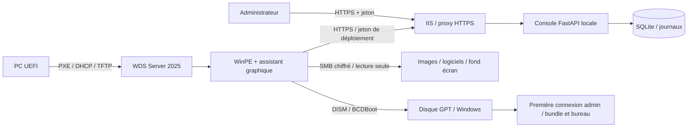

# Atelier PXE

Console de déploiement Windows conçue pour une installation neuve sur **Windows Server 2025, 192.168.99.250**. Elle utilise **WDS pour le démarrage réseau**, une image **WinPE x64 dédiée**, puis **DISM et BCDBoot** pour préparer Windows. Aucun MDT préexistant n’est requis.

La version **0.2** ajoute un assistant graphique directement sur le PC démarré par PXE : sélection de Windows, nom du poste, clavier, région, fuseau horaire, logiciels/bundles, thème et fond d’écran. La console web prépare le catalogue et les autorisations. L’agent vérifie la MAC, l’UEFI, les SHA-256 et le disque avant de supprimer ses partitions.

La révision **INTERNE-1** ajoute un [parcours interne à activer sur le serveur](docs/MODE-INTERNE.md) : console sans jeton, connexion WinPE sans code ni mot de passe SMB à saisir, récapitulatif sans phrase de confirmation, nom `LE-T15-` suivi des quatre derniers chiffres du numéro de série BIOS, compte Administrateur sans mot de passe, progression dans Windows et maintenance automatique. Le dossier **C:\IQ_** reçoit le rapport batterie, le diagnostic de licence et une copie du fond d'écran.


Cette première version est un atelier **supervisé**, à valider sur un PC de laboratoire. Le code Windows est fourni mais n’a pas été exécuté sur Server 2025/WinPE dans l’environnement Linux de développement. Un état `staged` signifie « image appliquée et démarrage préparé » ; les clients ATELIER-2 transmettent ensuite les états Windows et leur rapport à la console.


## Parcours ATELIER-2

Le [guide utilisateur](docs/GUIDE-UTILISATEUR.md) présente l’atelier à une personne qui découvre le projet. La [procédure ATELIER-2](docs/MISE-A-JOUR-ATELIER-2.md) décrit la mise à jour de DEPLOY-01 et la reconstruction WinPE.

Cette révision ajoute le détail Windows Update, masque les consoles de fond, ouvre HP Image Assistant sur les HP équipés, prépare les profils Pro/Famille depuis le WIM, désactive le démarrage rapide Windows et génère un PDF local avec remontée dans la console. Le dossier IQ_ contient les tests audio/webcam/clavier et une vérification de garantie assistée sur les portails officiels HP, Lenovo et Dell. Dans la console, **Guide utilisateur** ouvre la documentation intégrée.

## Installer sur votre serveur

Si le premier démarrage Windows est bloqué par le fichier de réponses, [récupérer les journaux depuis l’hôte Hyper-V](docs/DIAGNOSTIC-PREMIER-DEMARRAGE.md). Le collecteur monte le disque de la VM arrêtée en lecture seule et copie le diagnostic sur l’hôte.

Pour le test actuel dans la VM **PC-TEST-PXE**, suivre [l'activation et le test du mode interne](docs/MODE-INTERNE.md). La [reconstruction WinPE](docs/REPRISE-PXE.md) vérifie les partitions et sécurise l’écriture des fichiers de personnalisation. Si un ancien fichier de réponses contient uniquement des octets nuls, utiliser [la réparation du Windows déjà appliqué](docs/REPARATION-UNATTEND.md).

Pour mettre à jour votre VM **DEPLOY-01 / 192.168.99.250** déjà installée, suivre [l’assistant PXE et le test physique HP pas à pas](docs/ASSISTANT-PXE.md). Le premier client est un **HP EliteBook 850 G6**. L’hôte Hyper-V est `192.168.99.253` et le DHCP existant est fourni par le routeur `192.168.99.1`.

Les bundles accueillent VLC, un lecteur PDF, Chrome et les outils constructeurs. HP Image Assistant est proposé sur HP, Lenovo System Update sur Lenovo. Les autres marques reçoivent les logiciels communs. Les logiciels sont préparés pendant WinPE, puis installés à la première connexion administrateur ; le fond d’écran et le thème s’appliquent au premier compte. Les installateurs et médias Microsoft sont fournis séparément par leurs éditeurs.

Pour le premier essai, suivre [la procédure de test pas à pas](docs/PROCEDURE-TEST.md) : console locale, réseau HTTPS/WDS, refus d’effacement puis installation sur un disque de laboratoire.

Suivez [le guide Windows Server 2025](docs/INSTALLATION.md). Il couvre Python, WDS, ADK, WinPE, HTTPS, SMB, le DHCP et le premier poste. Les scripts préservent une installation WDS existante et désactivent par défaut les réponses PXE lors d’une installation neuve.

## Développer dans le cloud

Dans `/workspace/mdt-serveur`, avec Python 3.12 :

```bash
python3 -m venv .venv
.venv/bin/python -m pip install -c constraints.txt -r requirements-dev.txt
.venv/bin/python -m pytest -q
.venv/bin/python -m uvicorn app.main:create_app --factory --host 127.0.0.1 --port 8080
```

La console génère un jeton dans `data/admin-token`. Lisez-le localement pour ouvrir la console ; ne le partagez pas et ne l’ajoutez pas à Git. Le jeton reste uniquement en mémoire dans l’onglet du navigateur. Les fichiers de données et les images ne sont pas suivis dans Git.

Les postes PXE de votre LAN ne peuvent pas démarrer depuis une instance cloud isolée : installez la console et WDS sur le serveur de votre réseau.

Pour générer une archive transférable au serveur : `python scripts/package.py`. Elle contient le code et la documentation, sans images Windows, base, jeton ni environnement virtuel.

## Architecture



Le transport iPXE/wimboot est disponible en option avec `/boot/menu.ipxe`. WDS est le parcours recommandé ici et ne dépend pas d’iPXE. Les fichiers Microsoft, licences Windows, drivers et binaires de démarrage ne sont pas distribués avec le logiciel.

Consultez [l’API et les états](docs/API.md) et [les limites et la recette de validation](docs/VALIDATION.md).
