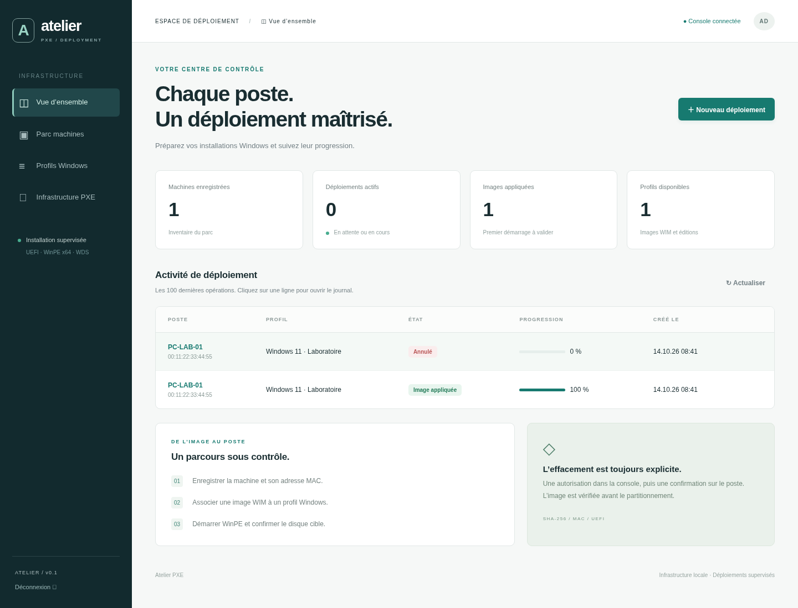
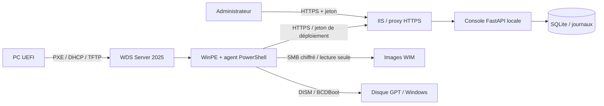

# Atelier PXE

Console de déploiement Windows conçue pour une installation neuve sur **Windows Server 2025, 192.168.99.250**. Elle utilise **WDS pour le démarrage réseau**, une image **WinPE x64 dédiée**, puis **DISM et BCDBoot** pour préparer Windows. Aucun MDT préexistant n’est requis.

La console web en français fournit l’inventaire MAC, les images WIM vérifiées par SHA-256, les profils d’édition/langue, l’autorisation de déploiement, les journaux et l’annulation. L’agent vérifie la machine, l’UEFI, la source et le disque, puis exige une confirmation locale avant de supprimer ses partitions.



Cette première version est un atelier **supervisé**, à valider sur un PC de laboratoire. Le code Windows est fourni mais n’a pas été exécuté sur Server 2025/WinPE dans l’environnement Linux de développement. Un état `staged` signifie « image appliquée et démarrage préparé » ; le premier démarrage Windows n’est pas certifié par la console.

## Installer sur votre serveur

Pour votre VM **DEPLOY-01 / 192.168.99.250**, suivre [la suite d’installation personnalisée](docs/SUITE-INSTALLATION.md). L’hôte Hyper-V est `192.168.99.253` et le DHCP existant est fourni par le routeur `192.168.99.1`.

Pour le premier essai, suivre [la procédure de test pas à pas](docs/PROCEDURE-TEST.md) : console locale, réseau HTTPS/WDS, refus d’effacement puis installation sur un disque de laboratoire.

Suivez [le guide Windows Server 2025](docs/INSTALLATION.md). Il couvre Python, WDS, ADK, WinPE, HTTPS, SMB, le DHCP et le premier poste. Les scripts préservent une installation WDS existante et désactivent par défaut les réponses PXE lors d’une installation neuve.

## Développer dans le cloud

Dans `/workspace/mdt-serveur`, avec Python 3.12 :

```bash
python3 -m venv .venv
.venv/bin/python -m pip install -c constraints.txt -r requirements-dev.txt
.venv/bin/python -m pytest -q
.venv/bin/python -m uvicorn app.main:create_app --factory --host 127.0.0.1 --port 8080
```

La console génère un jeton dans `data/admin-token`. Lisez-le localement pour ouvrir la console ; ne le partagez pas et ne l’ajoutez pas à Git. Le jeton reste uniquement en mémoire dans l’onglet du navigateur. Les fichiers de données et les images ne sont pas suivis dans Git.

Les postes PXE de votre LAN ne peuvent pas démarrer depuis une instance cloud isolée : installez la console et WDS sur le serveur de votre réseau.

Pour générer une archive transférable au serveur : `python scripts/package.py`. Elle contient le code et la documentation, sans images Windows, base, jeton ni environnement virtuel.

## Architecture



Le transport iPXE/wimboot est disponible en option avec `/boot/menu.ipxe`. WDS est le parcours recommandé ici et ne dépend pas d’iPXE. Les fichiers Microsoft, licences Windows, drivers et binaires de démarrage ne sont pas distribués avec le logiciel.

Consultez [l’API et les états](docs/API.md) et [les limites et la recette de validation](docs/VALIDATION.md).
