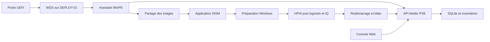

# IQ Atelier PXE

Atelier PXE déploie Windows depuis **DEPLOY-01, 192.168.99.250**, avec WDS pour le démarrage réseau, WinPE x64, DISM et BCDBoot. La console Web suit les postes, les pilotes HP, les rapports et les statistiques. L’installation ne nécessite pas un ancien environnement Microsoft MDT.

La version fonctionnelle publiée est **IQ-6.3**. Les mises à jour de documentation ultérieures ne changent pas ce numéro. La branche de travail et de publication est **`codex/atelier-2`**. La version réellement installée sur le serveur et celle de son image WinPE doivent être vérifiées sur place ; la publication GitHub ne prouve pas leur installation.

## Reprendre le projet, notamment dans Claude

Lire dans cet ordre :

1. [AGENTS.md](AGENTS.md), règles de rédaction, d’encodage et de validation.
2. [CLAUDE.md](CLAUDE.md), points d’entrée pour Claude Code.
3. [Passation du projet](docs/PASSATION-PROJET.md), état actuel, décisions et vérifications restantes.
4. [Guide utilisateur](docs/GUIDE-UTILISATEUR.md), [états et suivi](docs/ETATS-ET-SUIVI.md), puis [journal des modifications](docs/CHANGELOG.md).

```bash
git clone --branch codex/atelier-2 https://github.com/erik-iq/mdt-serveur.git
cd mdt-serveur
```

Le dossier de passation résume les décisions connues dans la conversation de travail. Les discussions ChatGPT originales ne sont pas présentes dans Git ; leur export doit être fourni séparément si nécessaire.

## Parcours actuel du poste

1. Démarrer en PXE et choisir le profil Windows et le disque dans l’assistant WinPE. Le numéro de série identifie le PC, y compris lorsqu’une station d’accueil est utilisée.
2. Confirmer localement l’effacement. DISM applique l’édition choisie depuis le partage SMB, puis le poste redémarre vers Windows.
3. Exécuter HPIA en premier si sélectionné, avec analyse et installation des SoftPaq compatibles. Les reprises liées aux redémarrages HP sont conservées.
4. Installer les logiciels sélectionnés, appliquer la personnalisation et préparer **C:\IQ_**.
5. En cas de réussite et selon les contrôles de finalisation, redémarrer automatiquement, vérifier la reprise et transmettre le bilan.
6. Archiver les rapports et inventaires sur le serveur avant le nettoyage du dossier de travail privé. Le dossier IQ reste disponible.

**Les KB, Windows Update et Microsoft Store restent manuels pendant la préparation des nouveaux postes.** Les anciens scripts de mise à jour et la maintenance WIM restent présents pour compatibilité et consultation ; ils ne définissent pas le parcours actuel.

L’image et les profils français sont conservés avec les réglages suisses du mode interne : région `fr-CH`, clavier `100c:0000100c`, fuseau `W. Europe Standard Time`. La langue du média et du profil doit être vérifiée séparément ; une image française `fr-FR` n’est pas renommée artificiellement en média `fr-CH`.

Plusieurs postes distincts peuvent être déployés en parallèle. Le débit du réseau et le stockage du serveur influencent les durées. Un même poste ne peut pas avoir deux autorisations WinPE actives simultanément.

## Console et mesures

- Vue globale, parc machines, profils Windows, HPIA et pilotes, correctifs Windows, statistiques.
- Modes clair, sombre et automatique. L’espace de stockage est présenté dans la vue globale.
- Six étapes suivies : Image Windows, HPIA, Logiciels, Dossier IQ, Redémarrage et Bilan. Les résultats non transmis restent non confirmés.
- Cache HP, dernière actualisation et source déclarée par le poste sont distincts. Une actualisation du cache échouée ne suffit pas à déclarer le déploiement en échec.
- Statistiques des déploiements terminés, durées mesurées par modèle et étapes les plus longues.
- Avec WinPE IQ-6.3 : débit reçu pendant DISM, liaison déclarée, volume et durée par poste. Les compteurs indisponibles et les anciennes installations restent non mesurés. Le trafic connexe est inclus et le multicanal SMB n’est pas agrégé.

## Architecture



Les composants et fichiers à modifier selon le besoin sont détaillés dans la [passation](docs/PASSATION-PROJET.md). Les contrats sont décrits dans [l’API](docs/API.md).

## Installer ou mettre à jour le serveur

Consulter [l’installation Windows Server](docs/INSTALLATION.md) et [la procédure ATELIER-4](docs/ATELIER-4.md). Pour une mise à jour complète, utiliser **`scripts/Upgrade-Atelier4.ps1`** depuis une copie séparée de la révision publiée. Ce script met à jour la console et reconstruit WinPE sur Windows avec l’ADK, les pilotes et le certificat du serveur.

Les changements des scripts embarqués nécessitent une reconstruction WinPE. Une simple mise à jour du site ne modifie pas une image déjà importée dans WDS et ne relance pas la préparation d’un poste terminé.

Le dépôt ne contient pas les WIM, les pilotes en cache, les bases de production, les certificats privés ou les identifiants du serveur. Leurs chemins dépendent notamment de `data-runtime.json`, présent uniquement sur l’installation.

## Développer et vérifier

Avec Python 3.12 :

```bash
python3 -m venv .venv
.venv/bin/python -m pip install -c constraints.txt -r requirements-dev.txt
.venv/bin/python -m pytest -q
.venv/bin/python -m uvicorn app.main:create_app --factory --host 127.0.0.1 --port 8080
```

Pour les contrôles navigateur, installer les dépendances de `requirements-browser.txt`, fournir Chromium puis exécuter le scénario concerné dans `tests/browser_*.py`. Pour les tests PowerShell portables, définir `ATELIER_PWSH` vers l’exécutable `pwsh`. Les tests propres à Windows sont ignorés sur Linux ; ce résultat ne remplace pas leur exécution native.

Après une modification de texte, exécuter `tests/test_source_encoding.py`. Après une modification PowerShell, exécuter `scripts/Test-PowerShellSyntax.ps1` et les tests concernés. Le français reste accentué, les scripts PowerShell sont en UTF-8 avec BOM, et les tirets longs sont interdits. Les contrôles automatisés ne remplacent pas une validation physique WinPE/HPIA sur le serveur et les postes.

Pour produire une archive de sources :

```bash
python3 scripts/package.py
```

L’archive `dist/atelier-pxe-0.2.0.zip` contient le code, les guides et la passation. Le numéro technique `0.2.0` du paquet est distinct de la révision d’interface IQ-6.3. Les données de production et l’environnement virtuel sont exclus.

## Documentation historique

Les guides [ATELIER-2](docs/MISE-A-JOUR-ATELIER-2.md), [ATELIER-3](docs/ATELIER-3.md), les anciens essais Windows Update et les passages de maintenance WIM décrivent des états antérieurs ou des outils spécialisés. Pour déterminer le comportement courant, partir de la passation, des dernières entrées du changelog et du code de la branche `codex/atelier-2`.
