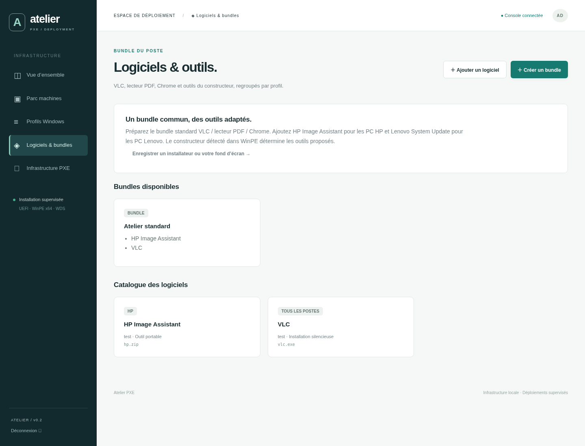

> Pour le nouveau parcours sans jeton/code, avec compte automatique, nom BIOS, mises à jour et dossier IQ_, suivre [MODE-INTERNE.md](MODE-INTERNE.md). Ce guide conserve le parcours authentifié.

# Assistant PXE 0.2 — reprise sur DEPLOY-01

Votre serveur de déploiement est **DEPLOY-01 / 192.168.99.250**. L’hôte Hyper-V est **192.168.99.253**, le routeur/DHCP **192.168.99.1**. IIS, Python, WDS, ADK et le module WinPE sont déjà installés. Ce guide reprend à la mise à jour du logiciel ; il ne faut pas relancer l’installation initiale.

Le premier PC physique est un **HP EliteBook 850 G6**, connecté en Ethernet au même LAN. L’assistant affiche sa marque, son modèle et les MAC détectées avant toute connexion au serveur. Le parcours prend en charge les **PC UEFI x64** de plusieurs marques ; chaque modèle doit disposer de pilotes Ethernet et stockage compatibles dans WinPE et d’une configuration compatible avec le Windows choisi. ARM64 et BIOS legacy ne sont pas pris en charge dans cette version.



Pour reprendre le test dans **PC-TEST-PXE** avec une nouvelle image et le menu de relance **FR-REPRISE-3**, suivre [la procédure de reconstruction et de test Hyper-V](REPRISE-PXE.md).

## 1. Mettre à jour la console existante

Télécharger [le ZIP du projet](https://github.com/erik-iq/mdt-serveur/archive/refs/heads/main.zip). Dans les propriétés du ZIP, cliquer **Débloquer** si proposé. Extraire dans **C:\AtelierPXE\mise-a-jour**, hors de la console actuelle. Vérifier le dossier réel :

```text
C:\AtelierPXE\mise-a-jour\mdt-serveur-main\scripts\Update-Console.ps1
```

Dans **PowerShell administrateur, sur DEPLOY-01** :

```powershell
Set-ExecutionPolicy -Scope Process -ExecutionPolicy RemoteSigned
$atelierSource = 'C:\AtelierPXE\mise-a-jour\mdt-serveur-main'
Get-ChildItem "$atelierSource\scripts" -File -Recurse | Unblock-File
& "$atelierSource\scripts\Update-Console.ps1" -SourcePath $atelierSource
Invoke-RestMethod https://192.168.99.250/health
```

Adapter seulement `$atelierSource` si l’extraction donne un autre dossier. Attendu : **status = ok, version = 0.2.0**. Faire **Ctrl+F5** dans la console : le menu **Logiciels & bundles** apparaît. Votre jeton administrateur reste celui déjà installé.

Le script arrête la tâche console, sauvegarde le code et SQLite dans **D:\AtelierPXE\backups\console-date-heure**, copie la nouvelle version et redémarre la tâche. La sauvegarde est réservée à Administrateurs/SYSTEM. SQLite est sauvegardé avec son API pour inclure le journal WAL. Le script conserve `.venv`, `data-runtime.json`, `.env`, le jeton, les images, IIS et les certificats. La migration ajoute des colonnes/tables et conserve les anciens profils et autorisations. Faire cette maintenance sans déploiement en cours.

En cas d’erreur, le script laisse la tâche arrêtée pour diagnostic. Lire **D:\AtelierPXE\data\logs\console.log** et l’erreur PowerShell. Pour restaurer la version précédente : garder la tâche arrêtée, recopier le contenu du sous-dossier privé `console` de la sauvegarde vers `C:\AtelierPXE\console`, puis restaurer `deployment.sqlite3` vers le dossier de données. Avant restauration de SQLite, déplacer les éventuels fichiers `deployment.sqlite3-wal` et `deployment.sqlite3-shm` dans un dossier privé distinct ; ne pas les conserver à côté d’une base restaurée. Si les dépendances ont changé, réinstaller celles de la version restaurée avec son `constraints.txt`. Redémarrer ensuite la tâche et contrôler `/health`. Ne pas publier ou joindre la sauvegarde : elle contient des données privées.

## 2. Préparer WinPE pour plusieurs modèles

Les pilotes WinPE permettent de voir **le réseau et les disques pendant l’installation**. Ils sont distincts des outils HP/Lenovo installés dans Windows. Les outils du constructeur ne peuvent pas réparer une absence de réseau au démarrage PXE.

Depuis les sources officielles des constructeurs, télécharger des packs **WinPE x64 signés** et les extraire, par exemple :

```text
D:\AtelierPXE\Drivers\WinPE-x64\HP\...
D:\AtelierPXE\Drivers\WinPE-x64\Lenovo\...
D:\AtelierPXE\Drivers\WinPE-x64\Dell\...
```

Ce dossier doit contenir les fichiers **.inf, .sys et .cat** extraits. Ne pas y placer uniquement les installateurs .exe. Pour le HP 850 G6, commencer par le pack WinPE HP correspondant à sa génération et contrôler les pilotes Ethernet/stockage réellement nécessaires. Les adaptateurs USB-C/docks peuvent avoir leur propre MAC et leurs propres pilotes. Au premier essai, préférer le port Ethernet intégré si disponible.

## 3. Reconstruire l’image avec l’assistant graphique

La nouvelle interface nécessite une **nouvelle image WinPE** contenant tous les scripts. La mise à jour de la console seule ne modifie pas les anciennes images WDS.

```powershell
Set-Location C:\AtelierPXE\console
.\scripts\Build-WinPE.ps1 `
  -ServerUrl 'https://192.168.99.250' `
  -OutputPath 'D:\AtelierPXE\WinPE-v3' `
  -TrustedRootCertificate 'C:\AtelierPXE\certs\AtelierPXE-lab.cer' `
  -DriversPath 'D:\AtelierPXE\Drivers\WinPE-x64' `
  -ImportIntoWds
```

Utiliser un autre nouveau dossier si `WinPE-v3` existe déjà. Si aucun pilote supplémentaire n’est encore disponible, omettre `-DriversPath` pour le premier contrôle, puis reconstruire après diagnostic si réseau/disque manque. Ne pas écraser les images précédentes. Attendu dans WDS : **Atelier PXE - Assistant Windows x64**. Garder les réponses PXE désactivées jusqu’à l’essai supervisé.

Les nouvelles images démarrent avec le clavier **français AZERTY**. Pour un autre clavier opérateur, fournir `-WinPEKeyboardLayout '100c:0000100c'` pour le suisse romand, ou `'0409:00000409'` pour l’anglais US. Ce réglage concerne la saisie dans WinPE ; le profil définit séparément le clavier du Windows installé.

L’écran Connexion propose aussi le choix du clavier et un champ de test avant les identifiants. Après fermeture ou erreur, le menu permet de relancer dans un nouveau processus. Au terminal, taper **`atelier`** suffit sur les images **FR-REPRISE-1** ; le choix **5** affiche le journal de démarrage et le réseau.

Sur une ancienne image qui démarre en QWERTY, fermer l’assistant avant le début d’une installation pour retrouver le terminal, puis exécuter :

```cmd
wpeutil SetKeyboardLayout 040c:0000040c
powershell.exe -STA -NoProfile -ExecutionPolicy Bypass -File X:\Atelier\Launch.ps1
```

Le changement manuel vaut pour la session WinPE actuelle. Dans la connexion Hyper-V standard, le collage simule une frappe et peut dépendre du clavier de l’hôte ; saisir manuellement les identifiants pour le premier essai après changement.

## 4. Importer votre Windows et ses éditions

Le produit propose les versions réellement enregistrées sur votre serveur. Il n’inclut aucun ISO Windows. Pour votre demande **26H2**, utiliser le média officiel correspondant à vos droits et vérifier sa version réelle ; le champ « Version Windows » est un libellé, il ne transforme pas un média plus ancien en 26H2. La disponibilité du média 26H2 n’a pas pu être vérifiée auprès de Microsoft depuis l’environnement de développement.

Ouvrir [la page officielle Windows 11](https://www.microsoft.com/fr-fr/software-download/windows11) ou votre portail Microsoft de licences. Télécharger **x64**, puis monter l’ISO sur DEPLOY-01. Dans les commandes suivantes, remplacer **E:** par la lettre réelle du média et le nom du WIM par la version vérifiée.

Si `E:\sources\install.wim` existe :

```powershell
Copy-Item E:\sources\install.wim D:\AtelierPXE\data\artifacts\Windows11-FR-v1.wim
Get-WindowsImage -ImagePath D:\AtelierPXE\data\artifacts\Windows11-FR-v1.wim
Get-WindowsImage -ImagePath D:\AtelierPXE\data\artifacts\Windows11-FR-v1.wim -Index 1 |
  Format-List ImageName,Version,Architecture,Languages
```

La seconde commande détaillée prend **l’index réel choisi**, pas nécessairement 1. Si le média contient un ESD :

```powershell
dism.exe /Get-WimInfo /WimFile:E:\sources\install.esd
$atelierIndex = Read-Host 'Index de l edition a exporter'
dism.exe /Export-Image /SourceImageFile:E:\sources\install.esd "/SourceIndex:$atelierIndex" /DestinationImageFile:D:\AtelierPXE\data\artifacts\Windows11-FR-v1.wim /Compress:max /CheckIntegrity
dism.exe /Get-WimInfo /WimFile:D:\AtelierPXE\data\artifacts\Windows11-FR-v1.wim
```

Vérifier le succès DISM avant de poursuivre. Un export d’une seule édition vers un nouveau WIM donne généralement l’index **1**. Ne pas modifier un fichier déjà enregistré ; utiliser un nouveau nom pour la prochaine version. Les WIM fractionnés/SWM ne sont pas acceptés.

Dans **Profils Windows → Enregistrer un fichier**, enregistrer ce WIM, type **Image Windows**. Les différentes éditions utilisent l’index correspondant ; différentes versions/langues peuvent utiliser plusieurs WIM. La langue d’interface doit exister dans l’image choisie. Le clavier, la région et le fuseau se choisissent séparément.

## 5. Enregistrer le fond d’écran et les logiciels

Copier votre image **PNG ou JPEG** dans **D:\AtelierPXE\data\artifacts**, par exemple `Fond-Atelier.jpg`. Depuis **Logiciels & bundles → Enregistrer un installateur ou votre fond d’écran**, enregistrer le fichier comme **Fond d’écran**.

Télécharger les installateurs x64 depuis leurs éditeurs, puis les copier dans ce même dossier et les enregistrer comme **Installateur / archive de logiciel**. Les noms de fichiers doivent être simples, sans espace. Les exécutables/MSI doivent avoir une signature éditeur valide, contrôlée avant leur exécution.

| Logiciel | Source officielle | Configuration du catalogue |
|---|---|---|
| VLC Media Player | [VideoLAN](https://www.videolan.org/vlc/) | EXE x64, tous les postes ; argument silencieux `/S`, à vérifier pour la version téléchargée |
| Lecteur PDF de votre choix | Site officiel de l’éditeur ; par exemple [Adobe Reader](https://get.adobe.com/fr/reader/enterprise/) | MSI ou EXE signé ; utiliser les paramètres silencieux documentés par l’éditeur |
| Google Chrome | [Chrome Enterprise](https://chromeenterprise.google/browser/download/) | MSI x64, tous les postes ; arguments supplémentaires vides pour le MSI standard |
| HP Image Assistant | [Page HP HPIA](https://ftp.ext.hp.com/pub/caps-softpaq/cmit/HPIA.html) | ZIP des fichiers extraits de l’outil, mode **Outil portable**, point d’entrée `HPImageAssistant.exe`, constructeur **HP** |
| Lenovo System Update | [Lenovo System Update](https://support.lenovo.com/fr/fr/solutions/ht037099) | Installateur signé, constructeur **Lenovo** ; arguments silencieux de la version téléchargée |

Pour HP Image Assistant, extraire le paquet officiel, repérer l’exécutable signé et créer un ZIP contenant **tous ses fichiers nécessaires**, avec le chemin d’entrée relatif correct. Les chemins absolus, traversées de dossier et scripts comme point d’entrée sont refusés. L’outil est copié et un raccourci est créé ; il ne lance pas automatiquement de recherche de pilotes ni de mise à jour du BIOS. Installer Lenovo System Update prépare l’outil, sans déclencher sa mise à jour du matériel.

Dans **Ajouter un logiciel**, renseigner nom, version, fichier, mode, éventuel programme dans le ZIP, paramètres silencieux et constructeur. L’enregistrement contrôle les métadonnées et le SHA-256 ; il ne certifie pas qu’un paramètre silencieux fonctionne avec un installateur particulier. Tester chaque nouvelle version sur le PC de laboratoire.

Créer le bundle **Poste standard** : VLC + lecteur PDF + Chrome + HP Image Assistant + Lenovo System Update. Un HP reçoit les logiciels communs et l’outil HP ; un Lenovo reçoit les logiciels communs et l’outil Lenovo ; les autres marques reçoivent les logiciels communs. La liste est dédupliquée si un logiciel est sélectionné à la fois directement et par bundle.

## 6. Créer le profil Windows personnalisé

Dans **Profils Windows → Nouveau profil** : choisir le WIM et l’index réellement présents, puis saisir la version/édition vérifiées. Par exemple :

- Nom : `Windows 11 Pro FR — Atelier`.
- Langue de l’image : `fr-FR`, clavier français AZERTY, région `fr-FR`, fuseau Paris/Bruxelles.
- Propriétaire et organisation : facultatifs.
- Thème : clair, sombre ou conserver le thème Windows.
- Fond d’écran : votre fichier enregistré.
- Bundle : **Poste standard**.

Ces choix préremplissent l’assistant et restent modifiables avant l’installation si l’autorisation console le permet. Le nom du PC est saisi dans l’assistant. Cette version laisse les étapes OOBE de compte/licence à Windows : aucun mot de passe administrateur, AutoLogon ou contournement matériel n’est inclus.

## 7. Publier le partage de lecture, si nécessaire

Vérifier d’abord s’il existe :

```powershell
Get-SmbShare -Name AtelierImages -ErrorAction SilentlyContinue
Get-LocalUser -Name DeployRead -ErrorAction SilentlyContinue
```

S’ils n’existent pas, créer le compte non administrateur, puis le partage :

```powershell
$atelierReadPassword = Read-Host 'Mot de passe du compte DeployRead' -AsSecureString
New-LocalUser -Name DeployRead -Password $atelierReadPassword -Description 'Lecture des images et logiciels WinPE'
.\scripts\Publish-ImageShare.ps1 -Path 'D:\AtelierPXE\data\artifacts' -ReadOnlyAccount "$env:COMPUTERNAME\DeployRead"
```

Créer la règle SMB seulement si absente :

```powershell
if (-not (Get-NetFirewallRule -Name 'AtelierPXE-SMB' -ErrorAction SilentlyContinue)) {
  New-NetFirewallRule -Name 'AtelierPXE-SMB' -DisplayName 'Atelier PXE SMB LAN' -Direction Inbound -Action Allow -Protocol TCP -LocalPort 445 -RemoteAddress 192.168.99.0/24 -Profile Any
}
Get-SmbShareAccess -Name AtelierImages
```

Attendu : **Read** pour `DEPLOY-01\DeployRead`. Le partage expose seulement `artifacts`, avec chiffrement SMB. Tous les fichiers du bundle sont dans ce même dossier, à côté du WIM. Le mot de passe est saisi dans WinPE, sans l’incorporer à l’image de démarrage ni au Windows installé.

## 8. Premier démarrage du HP, sans effacement

Brancher le HP en **Ethernet** sur le LAN `.99.0/24`, sur alimentation secteur. Prévoir un disque de test dont les données peuvent être effacées pour le second passage ; ce premier passage contrôle seulement le démarrage. Sur DEPLOY-01, activer WDS pour l’essai supervisé :

```powershell
wdsutil.exe /Set-Server /AnswerClients:All
Start-Service WDSServer
```

Sur le HP : activer UEFI et le démarrage réseau dans le BIOS si nécessaire. Au démarrage, **Échap puis F9** ouvre généralement le menu HP ; sélectionner l’entrée **UEFI réseau IPv4 / Ethernet**, confirmer le PXE si demandé, puis choisir **Atelier PXE - Assistant Windows x64**. Garder Secure Boot activé avec une chaîne ADK/WDS à jour. Il n’est pas nécessaire d’ajouter systématiquement les options DHCP 66/67 au routeur sur ce même LAN.

Attendu : écran graphique **Connexion**, marque **HP**, modèle **EliteBook 850 G6**, MAC affichée. Noter la MAC de l’interface Ethernet utilisée. Sans code d’installation ni confirmation, aucun disque n’est effacé. Si l’assistant ne s’ouvre pas, noter l’erreur du terminal. Si le réseau manque, revenir au terminal et lancer `ipconfig /all` ; ajouter les pilotes nécessaires à l’étape 2, reconstruire WinPE, puis reprendre ce test.

Fermer l’assistant pour contrôler le disque, si nécessaire :

```cmd
powershell.exe -NoProfile -Command "Get-Disk | Format-Table Number,FriendlyName,SerialNumber,Size,BusType,IsSystem,IsBoot"
```

Ne pas lancer `clean` ou formater pendant ce contrôle. Relancer le graphique :

```cmd
powershell.exe -STA -NoProfile -ExecutionPolicy Bypass -File X:\Atelier\Launch.ps1
```

## 9. Autoriser le HP et parcourir l’assistant

Dans la console serveur, enregistrer le PC, par exemple **HP-TEST-01**, avec la MAC relevée. Créer un déploiement, choisir son profil, le **numéro réel du disque de test**, laisser coché **Autoriser le choix du profil et des paramètres dans l’assistant PXE**, puis saisir **EFFACER HP-TEST-01**.

La console affiche un code de 20 caractères, regroupés par quatre. Il est valable **deux heures**, réservé à la MAC et désactivé au début du déploiement. Conserver ce code localement. En cas d’expiration, annuler l’autorisation puis en créer une nouvelle. Aucun jeton administrateur n’est demandé sur le PC.

Dans WinPE :

1. **Connexion** : code PXE, compte `DEPLOY-01\DeployRead`, mot de passe du partage.
2. **Windows** : profil, version, édition et langue de l’image.
3. **Poste & région** : nom Windows, clavier, fuseau, région, organisation.
4. **Bundle & bureau** : logiciels, bundle, thème et fond d’écran. Les outils d’une autre marque sont désactivés.
5. **Récapitulatif** : contrôler modèle/taille/série du disque et les logiciels retenus.

Pour le premier parcours, **ne pas saisir la confirmation finale** : fermer l’assistant et annuler le job dans la console. Le choix de profil n’efface rien. Ce passage valide l’interface, le matériel, HTTPS et SMB.

## 10. Installer réellement sur le disque de test

Créer une nouvelle autorisation. Reprendre le parcours et vérifier le disque. Saisir la phrase exacte affichée, par exemple **EFFACER HP-TEST-01 DISQUE 0**, seulement pour le disque dont l’effacement est prévu. L’agent contrôle MAC, UEFI, disque interne, index/langue x64 et SHA-256 avant `diskpart clean`. Tous les volumes du disque sélectionné seront supprimés. Le numéro 0 n’est pas une valeur universelle.

L’écran suit les phases : validation, partitions GPT, DISM, préparation des logiciels et démarrage UEFI. **Image appliquée / 100 %** signifie que le Windows et le bundle ont été préparés. Fermer l’assistant, puis éteindre :

```cmd
wpeutil shutdown
```

Démarrer le HP sur son disque avec Windows Boot Manager. Terminer l’OOBE avec **un premier compte administrateur**. Les logiciels sélectionnés sont alors installés et le thème/fond d’écran appliqués à ce premier compte. Les logiciels installés pour tous les utilisateurs suivent les options de leur installateur ; les préférences de bureau des autres comptes ne sont pas configurées par cette version.

Contrôler localement en PowerShell administrateur :

```powershell
hostname
Get-TimeZone
Get-WinUserLanguageList
Get-Content C:\ProgramData\AtelierPXE\result.json -Raw
reagentc.exe /info
```

Attendu dans `result.json` : **completed**, les logiciels retenus et l’éventuel indicateur de redémarrage. Consulter aussi `first-logon.log` et les journaux MSI dans ce dossier. Si le premier compte n’est pas administrateur, ou si la commande de premier démarrage n’a pas été exécutée, ouvrir une session du compte à personnaliser puis PowerShell administrateur et lancer :

```powershell
& C:\ProgramData\AtelierPXE\FirstLogon.ps1
```

Après succès, cette commande ne réinstalle pas le bundle. Après un échec, examiner l’erreur avant reprise ; les installateurs déjà réussis peuvent être relancés. Vérifier les exigences CPU/TPM/Secure Boot, réseau, pilotes Windows, activation, versions des logiciels et apparence du bureau. Les résultats du premier démarrage ne sont pas encore remontés automatiquement dans la console : ils sont contrôlés sur le poste.

Pour chaque nouveau modèle, refaire d’abord le démarrage sans effacement et vérifier réseau/disque. À la fin de l’essai, annuler les jobs abandonnés et désactiver WDS si la distribution PXE doit être suspendue :

```powershell
wdsutil.exe /Set-Server /AnswerClients:None
```
